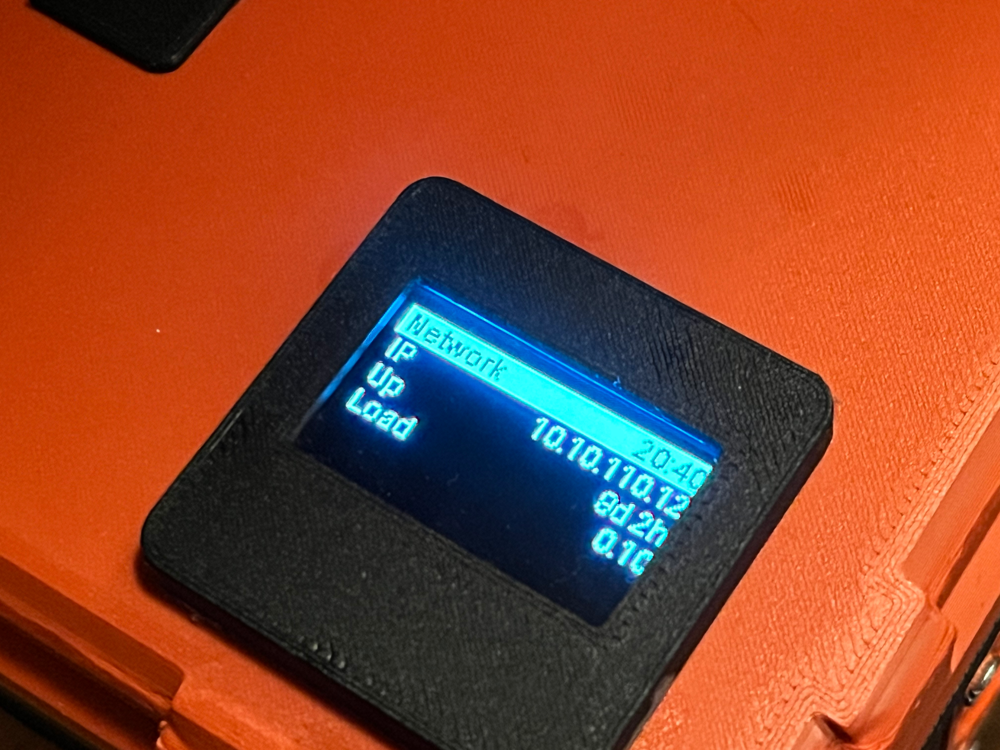

# HAOS OLED Info Display


[](https://github.com/psf/black) [](http://www.gnu.org/licenses/agpl-3.0) 

A Home Assistant OS add-on that cycles status pages on a small I2C OLED display. Intended to be used on Raspberry Pi hosts.

Works with:

- SSD1306 128x64 (for example the Dorhea 0.96 inch)
- SSD1306 128x32 (the common 0.91 inch modules)
- SH1106 128x64  (clones of the SSD ones, but work good too)

Tested on a Pi 5 connected to an 1.3" SH1106 display module, with HAOS 2026.10.1.

## Setup

1. Wire the display to the Pi: VCC to 3.3V or 5V (whichever the module is rated for), GND to GND, SDA to SDA, SCL to SCL. You can use [pinout.xyz](https://pinout.xyz) to locate those pins on your specific Pi.
2. Enable I2C on Home Assistant OS. The community [HassOS I2C Configurator](https://community.home-assistant.io/t/add-on-hassos-i2c-configurator/264167) add-on can make these changes for you, I tried doing it myself but couldn't really figure it out.
3. Go to the *Apps* section in your HASS settings, then click *Install app* on the bottom right. Click the three dots on the top right, select *Repositories* and add the URL to this repository. ([github.com/oipy-poipy/HAOS-OLED-Display.git](https://github.com/oipy-poipy/HAOS-OLED-Display.git))
4. Go back to the initial *Apps* section, click the refresh icon on the top right, then pres *Install app* again and you should see this addon in the installable apps. Install it.

(You can also do the installation manually by copying the contents of the `ha_pi_panel` directory to `/addons/ha_pi_panel` using the File Editor. You won't be able to get automatic updates though.)

## Options

| Option                   | Meaning                                                     |
| ------------------------ | ----------------------------------------------------------- |
| `display_type`         | `ssd1306_128x64`, `ssd1306_128x32` or `sh1106_128x64` |
| `display_i2c_address`  | Usually`0x3C`, sometimes `0x3D`                         |
| `display_rotate`       | Rotation in degrees: 0, 90, 180 or 270                      |
| `display_contrast`     | Brightness from 0 to 255                                    |
| `display_page_seconds` | How long each page stays on screen                          |
| `display_pages_json`   | The pages (see below)                                       |

## Pages

`display_pages_json` is a JSON list of pages. Each page has a list of `lines`. A 64 pixel high display fits 5 lines, a 32 pixel high one fits 3.

- A line that starts with `#` is drawn as an inverted header bar.
- A tab (`\t` in JSON) splits a line into a label and a right-aligned value.
- Text that does not fit is shortened with `…`.

Tokens in curly braces are filled in each time a page is shown:

| Token                                 | Value                                           |
| ------------------------------------- | ----------------------------------------------- |
| `{hostname}`, `{ip}`              | Name and LAN address of the Home Assistant host |
| `{clock}`, `{date}`               | `HH:MM` and `YYYY-MM-DD`                    |
| `{uptime_short}`                    | Host uptime, for example`3d 4h`               |
| `{cpu_temp_c}`, `{cpu_load_1m}`   | CPU temperature and 1 minute load average       |
| `{mem_percent}`, `{disk_percent}` | Memory and disk usage in percent                |

*Note - I like showing the load as %, so instead of 0.1 it will be 10%, 2.0 will be 200% and so on. I think it also makes more sense here since I don't think I've ever seen my fairly large HASS setup go above a 1.0 load avg.*

Home Assistant entities use `{ha:<entity_id>[@<attribute>][,<fallback>...][|<format>]}`:

- `{ha:sensor.outdoor_temperature}` shows the state.
- `{ha:weather.forecast_home@temperature}` shows an attribute.
- `{ha:sensor.outdoor_temperature,weather.forecast_home@temperature}` shows the first one that has a usable value.
- `|1°C` rounds to 1 decimal and appends `°C`. The format is an optional number of decimals followed by any suffix.

Weather states such as `partlycloudy` are shown as readable labels such as `Part cloud`. A value that cannot be read is shown as `--`.

The default pages:

```json
[
  {
    "name": "System",
    "lines": [
      "#{hostname}\t{clock}",
      "CPU\t{cpu_temp_c}°C",
      "RAM\t{mem_percent}%",
      "Disk\t{disk_percent}%"
    ]
  },
  {
    "name": "Network",
    "lines": [
      "#Network\t{clock}",
      "IP\t{ip}",
      "Up\t{uptime_short}",
      "Load\t{cpu_load_1m}"
    ]
  },
  {
    "name": "Home",
    "lines": [
      "#Home\t{clock}",
      "Out. Temp.\t{ha:sensor.balcony_temperature_sensor_temperature,weather.forecast_home@temperature}{ha:sensor.balcony_temperature_sensor_temperature@unit_of_measurement,weather.forecast_home@temperature_unit}",
      "Out. Humid.\t{ha:sensor.balcony_temperature_sensor_humidity,weather.forecast_home@humidity}%",
      "Out. Wind\t{ha:weather.forecast_home@wind_speed}{ha:weather.forecast_home@wind_speed_unit}"
    ]
  }
]
```

## Troubleshooting

- **`I2C device not found: /dev/i2c-1`**: I2C is not enabled. Follow step 2 of the setup and reboot the host.
- **`I2C device not found on address`**: Check the wiring and `display_i2c_address`. Try `0x3D`.
- **A value shows `--`**: The add-on log explains why, once per problem. A missing entity is logged as `HTTP Error 404`. Entity ids are case sensitive and are listed under Developer Tools, States. If nothing is logged, the entity exists but its value is unknown, unavailable, or the attribute name is wrong.
- **Turning the display off**: Stop the add-on. The display is blanked on exit, and automations can do this with the `hassio.addon_stop` and `hassio.addon_start` actions.
- **The add-on stopped after an error**: Turn on Watchdog on the add-on page and it will be restarted automatically.

## Showcase



## AI Disclosure

A lot of the code was slopped together with Claude, but I'm slowly remaking the whole thing myself. I've been trying to rely on it less lately and this project is kinda the start of that I think.
